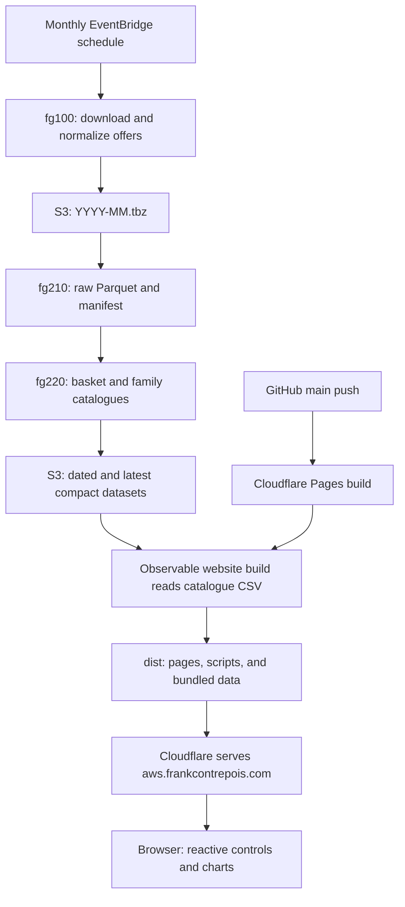

# AWS Pricing Graphs

The live site is at [aws.frankcontrepois.com](https://aws.frankcontrepois.com).

This repository is the presentation layer for investigating AWS public pricing.
It uses Observable Framework, Observable Plot, and D3 to turn small static
datasets into interactive charts and editorial analysis. It is moving from
one-off, current-price charts to reproducible monthly price histories.

The collection and historical transformation layer lives in the sibling
`FinOpsGuyCloudFormationRepository`. That repository archives AWS offer files,
converts them to Parquet, and produces curated historical datasets. This
repository should consume only compact extracts suitable for a static website.

## What the site currently publishes

| Page | Purpose | Data |
| --- | --- | --- |
| `src/index.md` | Introduce pricing questions and guide visitors to comparisons, regions, currency exposure, and S3 history. | Editorial homepage; no data loaders. |
| `src/regions.md` | Compare regional S3 and EC2 prices, EC2 generation availability, and service availability. | Observable data loaders calling AWS Pricing, EC2, and SSM APIs. |
| `src/fx-exposure.md` | Show how exchange rates change the local-currency cost of a constant USD invoice. | Checked-in monthly ECB-derived CSV. |
| `src/s3PriceHistory.md` | Explore S3 Standard price cuts and the long pause since the December 2016 reduction. | Manually curated AWS announcement dates and prices. |
| `src/comparisons/` | Compare exact-size EC2, RDS, ElastiCache, and OpenSearch instance generations, processors, and capability variants against a selected anchor. | As-of family catalogues published by the sibling pricing pipeline; checked-in AWS release dates for the EC2 timeline. |

Observable data loaders use names such as `src/data/example.csv.js`. During a
build, Observable executes the JavaScript loader, captures its standard output
as `example.csv`, and packages that generated file into the static site. The
browser does not call AWS APIs.

## How the whole system works, in order

There are three separate sequences: infrastructure deployment creates the AWS
resources; monthly jobs prepare the pricing data; website builds turn selected
data into pages and publish them through Cloudflare Pages.

### Who owns each part

| Part | Responsibility | Handoff |
| --- | --- | --- |
| `FinOpsGuyCloudFormationRepository` | CloudFormation templates, IAM roles, schedules, CodeBuild jobs, transformation scripts, and versioned dataset rules. | Publishes dated and latest CSV/Parquet datasets to S3. |
| AWS CloudFormation | Creates or updates the resources described by the templates. | Makes jobs and schedules available; deploying a template does not itself run a monthly transformation. |
| AWS CodeBuild | Executes the download and transformation commands, using the permissions granted by IAM. | Writes archives, raw Parquet, then compact datasets. |
| S3 `data.frankcontrepois.com` | Stores the archive and derived data shared between repositories. | Website builds read compact catalogue CSV files over HTTPS. |
| `aws.frankcontrepois.com` repository | Observable Markdown pages, data loaders, comparison adapters, charts, and editorial content. | Builds the static website into `dist/`. |
| Observable Framework | Runs loaders and generates pages during the build; supplies the browser runtime for reactive cells. | Bundles page assets and selected data for Cloudflare to serve. |
| Observable Plot, Inputs, and D3 | Draw charts, expose controls, and transform data in the visitor's browser. | Recompute views of bundled data when a visitor changes a control. |
| Cloudflare Pages | Builds the website from GitHub `main` and publishes `dist/`. | Serves the site at `https://aws.frankcontrepois.com/`. |

### 1. Create or update the AWS infrastructure

Bootstrap `fg000-setup.yml` to create the infrastructure CodeCommit repository
and `FinOpsGuy-dev-pipeline`. Its source is that repository's `master` branch.
The deployment actions in the checked-in template run in this order:

1. `fg000-setup.yml`: update the deployment pipeline and its supporting roles.
2. `fg100-setup-pricing.yml`: create the pricing download job and monthly schedule.
3. `fg200-data-elaboration.yml`: create the legacy current-snapshot extraction job.
4. `fg210-raw-parquet.yml`: create the archive-to-Parquet job.
5. `fg220-pricing-basket.yml`: create the basket and service-catalogue job.
6. `fg300-web-building.yml`: legacy Hugo/S3 website resources.

This is resource deployment order, not data-processing order. CloudFormation
provisions the jobs; CodeBuild executes them later. The `fg300` website path is
marked retired in the repository documentation, but remains a deployment action
in `fg000` and its template still defines a scheduled Hugo build. It is not the
current Observable/Cloudflare publishing path; this documentation update does
not remove or disable those legacy resources.

The AWS pipeline consumes CodeCommit, while the current website deployment
consumes GitHub. A local edit must reach the appropriate source repository and
branch before its deployment pipeline can use it. The templates do not define
an automatic GitHub-to-CodeCommit synchronization.

### 2. Run the monthly data sequence

1. The EventBridge Scheduler defined in `fg100` starts
   `FinOpsGuyDownloadPricingData` at 00:23 UTC on the first day of each month
   (`cron(23 0 1 * ? *)`; no alternate timezone is set in the template).
2. The download job fetches current AWS public offer CSV files, removes the
   preamble and `EffectiveDate`, cleans whitespace, and splits by offer term.
   It uploads the normalized `YYYY-MM.tbz` snapshot under
   `s3://data.frankcontrepois.com/FinOpsGuyAwsPricingRepository/`.
3. After uploading, it starts `FinOpsGuyAwsPricingRawParquet` with the same
   `SNAPSHOT_MONTH` and `TRIGGER_BASKET=true`. The `fg210` project runs
   `buildspecs/raw-parquet.yml`, which calls
   `pipeline/raw-parquet/process-range.sh`. It writes offer/month-partitioned
   Parquet and a monthly manifest.
4. After successful raw conversion, the buildspec starts
   `FinOpsGuyAwsPricingBasket` for that month. The `fg220` project runs
   `buildspecs/pricing-basket.yml`, then
   `pipeline/pricing-basket/process-range.sh` and `process-month.sh`.
5. The basket job reads that month's on-demand Parquet for EC2, RDS,
   ElastiCache, OpenSearch (`AmazonES`), S3, and Bedrock. Versioned rules in
   `config/` produce the historical pricing basket and four instance family
   catalogues. From the second month onward, the job also requires the previous
   month's dated basket and catalogue outputs.
6. The job publishes CSV and Parquet under
   `s3://data.frankcontrepois.com/FinOpsGuyAwsPricingElaboratedData/`.
   `YYYY-MM/pricing-basket.csv` contains history through that month;
   `YYYY-MM/<service>-family-catalog.csv` is a self-contained as-of catalogue.
   Undated names hold the newest published versions.



Each `StartBuild` call is asynchronous: an upstream job finishing does not prove
that downstream jobs finished. Check each CodeBuild result and the expected S3
outputs. For backfills, finish the raw range with `TRIGGER_BASKET=false`, then
run the basket range serially in ascending month order. The code defines the
four catalogues; confirm deployment and backfill completion before assuming
all their production objects exist.

### 3. Build and publish the Observable website

1. Pages under `src/` declare their data dependencies with `FileAttachment`.
   Checked-in CSV files supply FX reference data and EC2 lineage release dates, while current regional
   snapshot loaders query AWS Pricing, EC2, and SSM during the build.
2. For instance comparisons, `lib/instance-comparisons/` reads the latest
   `<service>-family-catalog.csv` from the elaborated S3 prefix over HTTPS.
   Local `*_CATALOG_SOURCE` overrides can select fixture files.
   `observablehq.config.js` discovers service/family routes from these
   catalogues, and parameterized Markdown loaders generate the pages.
3. Observable runs required `src/data/*.csv.js` loaders and captures their
   standard output as CSV. A page references the generated `.csv` name without
   the final `.js`. Development previews can reuse outputs under `src/.observablehq/cache`.
   `npm run build` clears that cache through its `prebuild` lifecycle;
   `npm run clean` also clears it explicitly.
4. `npm run build` generates `dist/`: static HTML, browser JavaScript, and
   bundled datasets. Browser cells use `FileAttachment`, Plot, Inputs, and D3
   to render and update charts. Visitors do not query the AWS APIs or scan raw
   Parquet. AWS credentials belong only in the build environment.
5. After local validation, an authorized push to the website's GitHub `main`
   branch triggers the connected Cloudflare Pages build. Cloudflare publishes
   `dist/` at the canonical domain. Its project settings and build credentials
   are managed outside these CloudFormation templates.
6. Check the commit's `Cloudflare Pages` result and inspect expected content on
   a changed canonical route. HTTP 200 alone can be a fallback response.

Publishing new S3 data does not automatically publish a new website. The shown
monthly chain ends at S3; it contains no Cloudflare build trigger. A subsequent
website build must read the new data and publish it before visitors see it, and
reused loader caches must be considered when checking freshness. The historical
`pricing-basket.csv` is produced upstream but is not yet consumed by a site
page; the instance catalogues already have website consumers. FX exposure and
manual S3 history follow their separate checked-in/editorial data paths.

### Order when adding a new data-backed feature

1. Define and test the producer rules and output contract in the infrastructure
   repository if a new historical dataset is needed.
2. Deploy the required AWS changes and complete any raw conversion or serial
   derived-data backfill; verify the compact S3 outputs.
3. Add or update the Observable loader, page, and chart in the website repository.
4. Validate the website build against the intended dataset, including coverage,
   units, and missing observations.
5. Push the website change when authorized, then verify Cloudflare publication.

A prose-only or chart-only website change can start at step 3. A monthly data
refresh uses the existing jobs and then a website rebuild; it does not require
redeploying all CloudFormation stacks.

## Data architecture

```text
AWS public offer files
  -> monthly TBZ archive in S3
  -> raw Parquet snapshots (all archived columns retained)
  -> compact historical price datasets
  -> small chart-specific extracts for this website
```

The first three stages are implemented in the sibling repository. The final
historical website integration is in progress: the current regional charts
still use direct AWS API loaders, and the new `pricing-basket.csv` is not yet
consumed here.

## Current data

- **Raw pricing snapshots:** monthly archives and partitioned Parquet in
  `s3://data.frankcontrepois.com/FinOpsGuyAwsPricingRepository/`.
- **Foreign exchange reference data:** `src/data/fx-usd-monthly.csv`, sourced
  from the European Central Bank. It is deliberately separate from AWS pricing
  data so charts can express USD list prices and local-currency equivalents
  independently.
- **FX exposure page:** `src/fx-exposure.md` holds a USD invoice constant and
  shows how exchange-rate movements change its local-currency equivalent. Its
  date controls filter the available monthly observations; each selected series
  is normalised to its first observation with Observable Plot.
- **Current website datasets:** loaders under `src/data/*.csv.js` query the AWS
  Pricing, EC2, and SSM APIs during the build and emit chart-specific CSV.
- **Historical pricing basket:** the sibling repository produces cumulative
  EC2, S3, and Bedrock history in both CSV and Parquet. A website page consuming
  that basket is the next planned integration.
- **Manual S3 history:** `src/s3PriceHistory.md` contains a curated series based
  on AWS price-reduction announcements because the current AWS Pricing API does
  not expose the required historical series.
- **Instance comparisons:** parameterized Observable page loaders under
  `src/comparisons/` generate service and family pages from embedded reusable
  Markdown templates and the service registry in `lib/instance-comparisons/`.
  The parameterized
  `src/data/[service]-family-catalog.csv.js` loader dispatches to the matching
  service adapter. EC2, RDS, ElastiCache, and OpenSearch are registered. RDS
  exposes cascading selectors for engine, edition, licensing, deployment,
  storage mode, and AWS operation; ElastiCache exposes its engine selector.
  Those dimensions stay fixed for equivalent peers. Set the service-specific
  `*_CATALOG_SOURCE` variable to an explicit local CSV path for deterministic
  local builds; production never silently falls back to fixture data.

### EC2 launch-date price comparison

EC2 family pages plot **current snapshot prices against hardware-lineage release
dates**, using `src/data/ec2-launch-dates.csv`. The dates come from the
[AWS EC2 Instance Types Guide release history](https://docs.aws.amazon.com/ec2/latest/instancetypes/doc-history.html)
and were checked on 3 November 2026. They describe lineage releases, not the
availability of every exact size or region. Unknown dates stay unavailable in
the table and those instances are explicitly omitted from the timeline.

The timeline and existing comparison tables use the same catalogue, exact
anchor, and peer-selection rules. Generation peers keep processor, capability
variant, exact size, and region fixed. Its price-view toggle offers:

- **Price index** (default): selected anchor = 100; candidate index =
  `100 × candidate hourly price / anchor hourly price`.
- **USD/hour**: the unmodified current hourly list price.

The amber dot and dashed baseline identify the selected anchor in either view.
Tooltips retain the source price; displayed table prices and indices are rounded.
An index of 110 means 10% above the anchor, matching +10% in the difference chart.
This is a comparison of current prices across generations, **not prices at
launch or a monthly historical price series**. Monthly first-observed dates
remain separate provenance and are never substituted for documented releases.
Update the checked-in release metadata from official evidence as new lineages
appear; the monthly pricing pipeline does not maintain it.

## Principles

- Preserve raw AWS snapshots so future questions can be answered again.
- Define a stable, explicit comparison key rather than treating AWS SKU changes
  as price changes.
- Publish a small number of trustworthy fields for each question or chart.
- Keep price history in USD; join FX at visualisation time.
- Treat FX charts as currency-exposure analysis, not evidence that AWS changed
  a list price. Consumption, taxes, payment terms, and hedging are outside this
  reference series.
- Show source and date coverage alongside published charts.

## Local development

```sh
npm install
npm run dev
```

Run a production build with:

```sh
npm run build
```

AWS-backed loaders require network access and an AWS credential chain that can
read the Pricing, EC2, and SSM APIs. `npm run build` always clears
`src/.observablehq/cache` through its `prebuild` lifecycle script, so each
production rebuild fetches fresh data. Development previews can reuse the cache.

## Deployment

The npm commands are local development and validation commands. A push to the
GitHub `main` branch triggers the connected Cloudflare Pages project, which
runs the static build and publishes the result at
[aws.frankcontrepois.com](https://aws.frankcontrepois.com). There is no manual
Observable Cloud deployment step.

For a release, push the validated commit, monitor its `Cloudflare Pages` check,
and inspect a changed canonical URL after promotion. Check the page title or
expected content as well as the status code because the host can return the
site fallback with HTTP 200 before a new parameterized route is live.

## Weekly refresh

`.github/workflows/weekly-rebuild.yml` runs every Monday at 07:23 UTC
(08:23 British Summer Time / 07:23 UK winter time), and supports manual runs
from GitHub Actions. Scheduled runs may start later when GitHub is busy.
It commits a UTC timestamp to `build-refresh.txt` on `main`; the existing
Cloudflare Pages Git integration then rebuilds the entire site. No additional
AWS jobs, deploy hooks, Cloudflare credentials, or SNS are needed.

The workflow waits up to 45 minutes for the `Cloudflare Pages` check on that
exact commit, then verifies all four canonical comparator CSVs against their
dated and latest S3 catalogues. The checker rejects stale/mixed months,
duplicate identities, different CSV contents, and HTTP-200 fallback pages.
It expects the current UTC snapshot month, so a failed monthly AWS pipeline
also fails the check. Failures appear in GitHub Actions and follow your GitHub
notification preferences; the workflow does not send separate messages.

For recovery, use **Actions → Weekly website rebuild → Run workflow**. To
verify an explicit month without rebuilding:

```sh
SNAPSHOT_MONTH=2026-10 python3 scripts/verify-deployment.py
```

The source pipeline remains independent: new S3 data appears on the website
at the next weekly refresh or an intervening push to `main`. This may take up
to a week. The GitHub workflow requires `contents: write` to update the marker
and `checks: read` to confirm Cloudflare's deployment.

## Extending the site

### Add a chart backed by a small static file

1. Put the file under `src/data/`.
2. Load it from a Markdown page with `FileAttachment` and `{typed: true}`.
3. Transform it in an Observable JavaScript cell and render it with Plot or an
   Observable input.
4. Include the source, units, snapshot coverage, and interpretation limits on
   the page.

### Add a current AWS snapshot

1. Add `src/data/<name>.csv.js`.
2. Filter the AWS response to an explicit product and price dimension.
3. Emit valid CSV to standard output; send diagnostics to standard error.
4. Include provenance and extraction-date fields when practical.
5. Reference `data/<name>.csv` from the page and validate with a clean build.

### Add historical pricing

Prefer extending the versioned pricing-basket configuration and pipeline in
`FinOpsGuyCloudFormationRepository`, then consume its compact output here. A
historical comparison should use a stable semantic key rather than SKU or rate
code, retain missing observations, keep AWS prices in USD, and join FX only at
visualisation time.

Reusable parsing, sorting, or presentation helpers belong in `src/components/`.
Explicit sidebar grouping can be added through the `pages` option in
`observablehq.config.js`.

## Repository boundaries

- Do not copy the raw AWS offer archive or broad Parquet datasets into this
  repository.
- Do not make browser-side AWS calls or expose AWS credentials in site code.
- Do not treat a currency-converted price movement as an AWS list-price change.
- Keep build outputs (`dist/`) and Observable caches out of version control.
- Prefer a narrow, documented dataset per published question over a generic
  dump of AWS pricing data.

## Technology

- [Observable Framework](https://observablehq.com/framework)
- Observable Plot and D3 for charts
- Static CSV/Parquet-derived data files published through the website build

## License

MIT
